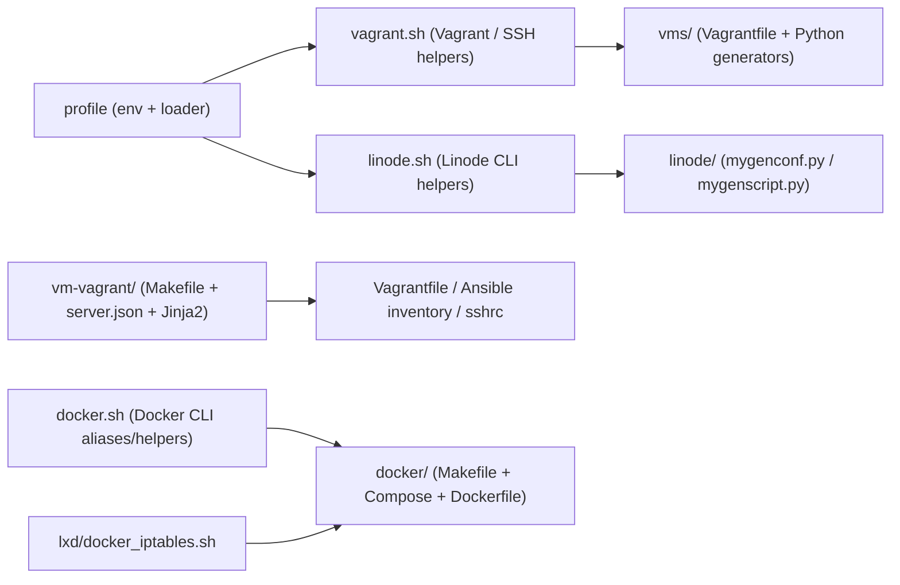

# vmscripts

Shell, Python, Vagrant, Docker Compose, Makefile, and Linode CLI utilities for spinning up multi-node virtual machine labs and local database sandboxes.

## Architecture Overview



## Repository Components

| Path | Technology | Purpose |
| :--- | :--- | :--- |
| `profile` | Bash | Exports `VMS_DIR`, `SCRIPT_DIR`, `DEFAULT_PRIVATE_KEY`, and sources `vagrant.sh` |
| `vagrant.sh` | Bash | Lifecycle wrappers (`vlist`, `vstart`, `vstop`, `vdelete`), inventory (`vgenInventory`), SSH helpers (`vssh_cmd`, `vssh_copy`, `vssh_exec`) |
| `docker.sh` | Bash | Container shortcuts (`dcu`, `dcd`, `dex`, `dps`, `dsa`, `dpsa`, `drm*`, `dfrom`, `dbash`) |
| `linode.sh` | Bash | Linode lifecycle and SSH/inventory wrappers (`llist`, `lcreate`, `ldelete`, `lssh`, `lgenInventory`) |
| `vms/` | Vagrant + Python | Standard multi-VM `Vagrantfile`, start/stop/status/destroy scripts, `mygenconf.py`, `mygenscript.py` |
| `vm-vagrant/` | Make + Jinja2 | JSON-driven (`server.json`) lab generator for `Vagrantfile`, Ansible config/inventory, PuTTY registry, and SSH keys |
| `big-vms/` | Vagrant | Single-VM Ubuntu 22.04 sandbox (`2548` MB RAM, `4` vCPU, forwarded ports `9000/3307/3308/5678`) |
| `docker/` | Docker + Make | Containerized MySQL, MariaDB, Galera, Cassandra, and PostgreSQL runners ([docker/README.md](docker/README.md)) |
| `linode/` | Python + Bash | Linode ELK/PostgreSQL/MariaDB script generators (`mygenconf.py`, `mygenscript.py`) |
| `lxd/` | iptables | `DOCKER-USER` forwarding rules allowing `lxdbr0` container bridge traffic |
| `installSoft*.sh` | Shell | Host workstation software bootstrap scripts for RHEL/Fedora (`dnf`) and Ubuntu (`apt`) |

## Quick Start

1. Clone the repository and load shell functions:

```bash
git clone https://github.com/jmrenouard/vmscripts.git
cd vmscripts
source ./docker.sh
source ./vagrant.sh
```

2. Generate Vagrant configs safely or inspect local Docker targets:

```bash
cd vm-vagrant && make generate_vagrantfile
cd ../docker && make create_secrets && make start_mariadb
```

> **Security Warning**: Several lab directories (`vms/`, `vm-vagrant/`, `big-vms/`, `linode/`) contain legacy sample SSH/PPK keys and lab passwords (`Admin2024_` in `docker/Makefile`). Generate fresh credentials (`make generate_keys` in `vm-vagrant/`) before exposing any host or cloud VM on shared networks.

## Documentation Portal

- **[Diátaxis Portal](docs/index.md)**: Structured [Tutorials](docs/01-tutorials/index.md), ASD-STE100 [How-To Guides](docs/02-how-to-guides/index.md), [Reference](docs/03-reference/index.md), and [Explanation](docs/04-explanation/index.md).
- **[howto.md](howto.md)**: Vagrant plugin setup and VM lab walkthrough.
- **[notes.md](notes.md)**: External `dbscripts` orchestration notes via `profile` and `vagrant.sh`.
- **[docker/README.md](docker/README.md)**: Docker Makefile, Compose, and Dockerfile reference.
