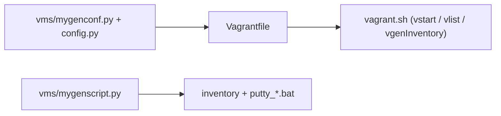

# Tutorial 1: Vagrant and Jinja2 VM Lab Setup

In this tutorial, you inspect and exercise the two Vagrant lab workflows in **vmscripts**: Python-generated topologies under `vms/` and JSON + Jinja2 templates under `vm-vagrant/`.

## Prerequisites

- Python 3 installed locally (`j2cli` and `ansible` optional for `vm-vagrant/Makefile`).
- VirtualBox and Vagrant installed if booting live virtual machines (`vms/init_vagrant.sh`).

## Step 1: Load the Vagrant Shell Helpers

Inspect `profile` first. Notice lines `3-4` assume `$HOME/GIT_REPOS/vmscripts/vms` and `$HOME/GIT_REPOS/dbscripts`. From inside your clone root, source `vagrant.sh` directly or point `VMS_DIR` to `$(pwd)/vms`:

```bash
export VMS_DIR="$(pwd)/vms"
export DEFAULT_PRIVATE_KEY="$VMS_DIR/id_rsa"
source ./vagrant.sh
```



## Step 2: Generate a Test `Vagrantfile` Safely with `vms/mygenconf.py`

You can test `vms/mygenconf.py` without overwriting `vms/Vagrantfile` by passing `output=` and parameter overrides matching `vms/config.py`:

```bash
cd vms
python3 mygenconf.py output=/tmp/Vagrantfile.test vm_number=2 vm_name_prefix=lab vm_ram=512
head -n 25 /tmp/Vagrantfile.test
```

`vms/mygenscript.py` builds matching `putty_<vm>.bat` scripts and an Ansible `inventory` containing `[control]` and `[target]` groups. Because `vms/mygenscript.py` does not cast CLI string arguments with `int()`, omit `vm_number=` so it reads the integer default (`5`) from `vms/config.py`. Run it inside an isolated working directory to keep your checkout clean:

```bash
mkdir -p /tmp/vmscripts_gen && cd /tmp/vmscripts_gen
PYTHONPATH=/path/to/vmscripts/vms python3 /path/to/vmscripts/vms/mygenscript.py vm_name_prefix=tut
cat inventory
```

## Step 3: Explore JSON + Jinja2 Provisioning in `vm-vagrant/`

Under `vm-vagrant/`, `server.json` acts as the single source of truth for five Jinja2 templates (`Vagrantfile.j2`, `alias_ssh.j2`, `ansible.cfg.j2`, `inventory.j2`, `puttyreg.reg.j2`). Look at `vm-vagrant/server.json`: each VM entry specifies `distro`, `prefix`, `ip_private`, `ip_private2`, `nbcpu`, `ram`, and an `enabled` flag (`1` enabled, `0` skipped).

When `j2cli` and `puttygen` are installed on Linux, generate fresh keys and artifacts via `vm-vagrant/Makefile`:

```bash
cd vm-vagrant
make generate_keys
make generate_vagrantfile
make generate_conf_ansible
make generate_bashrc
```

## Step 4: Initialize Vagrant Plugins and Inspect Status

Before running `vagrant up`, install the required VirtualBox plugins (`vagrant-vbguest`, `vagrant-hostmanager`, `vagrant-persistent-storage`) and verify them:

```bash
cd vms
sh init_vagrant.sh check
sh status.sh
```

> **Security Note**: Replace the legacy sample keys committed in `vms/id_rsa` and `vm-vagrant/id_rsa_vm` before booting VMs on non-isolated bridged networks (`public_network`).

## Next Steps

- Continue to [Tutorial 2: Docker Database Sandboxes and Linode Labs](02-docker-database-sandboxes-and-linode.md).
- Follow operational runbooks in [How to Provision Vagrant and Jinja2 Labs](../02-how-to-guides/provision-vagrant-and-j2-labs.md).
