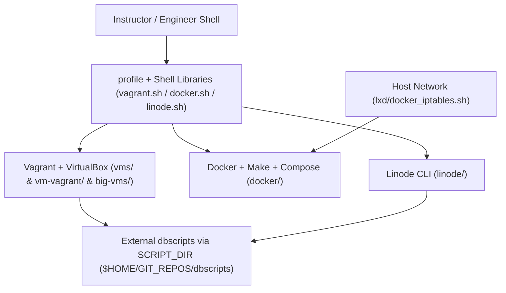

# VM and Container Lab Architecture

**vmscripts** evolves across four complementary lab tiers designed to balance full operating system fidelity against fast database container startup.

## Comparing `vms/` vs `vm-vagrant/` vs `docker/`

1. **Static + Python-Generated Vagrant (`vms/`)**: Pairs imperative shell wrappers (`start.sh`, `stop.sh`, `status.sh`, `genSshConfig.sh`) with `vms/mygenconf.py` and `vms/mygenscript.py` to generate VirtualBox VMs (`192.168.33.x` private subnets) alongside Windows PuTTY launchers (`putty_*.bat`) and Ansible `inventory`. `vagrant.sh` reads `$VMS_DIR/Vagrantfile` dynamically using `grep`/`perl` so `vssh_cmd`, `vssh_copy`, and `vssh_exec` can fan out commands without duplicating host lists.
2. **JSON + Jinja2 Template Driven (`vm-vagrant/`)**: Centralizes node definitions in `vm-vagrant/server.json` (`Vms.<node>.enabled`, dual private subnets `172.20.1.x` / `172.21.1.x`, CPU/RAM, VirtualBox group path) and renders five templates (`Vagrantfile.j2`, `inventory.j2`, `ansible.cfg.j2`, `alias_ssh.j2`, `puttyreg.reg.j2`) via `vm-vagrant/Makefile`. Enabling or disabling a VM requires changing a single `"enabled"` bit rather than hand-editing Ruby DSL blocks.
3. **Ephemeral Docker Containers (`docker/`)**: Bypasses hypervisor overhead via `docker/Makefile` targets that map distinct host ports (`3306` MySQL, `3309` MySQL 5.7, `3307` MariaDB, `3308` MariaDB 10.6, `5432` PostgreSQL, `9042`/`19042` Cassandra) against local named volumes and shared secret files under `docker/secrets/`.
4. **Bridged Host Coexistence (`lxd/`)**: When running Docker beside LXD on Linux hosts, Docker's default `DOCKER-USER` netfilter chain drops traffic traversing `lxdbr0`. `lxd/docker_iptables.sh` appends `ACCEPT` rules on `lxdbr0` so LXD-hosted labs keep external/container connectivity.

## Security Model and External Dependencies

- **Committed Lab Material**: Legacy training keys (`vms/id_rsa`, `vm-vagrant/id_rsa_vm`, `linode/id_rsa`, `big-vms/id_rsa_vm`) and sample passwords (`Admin2024_` in `docker/Makefile`, `eixo1hoo7Goo7suu9v` in `linode/config.py`) exist strictly for offline disposable VMs and must never be reused on reachable networks.
- **Separation From `dbscripts`**: Orchestration functions `vupdateScript` (`vagrant.sh`) and `lupdateScript` (`linode.sh`) delegate software installation payloads to `$_DIR/scripts/` (`SCRIPT_DIR="$HOME/GIT_REPOS/dbscripts"` in `profile`), keeping VM lifecycle management decoupled from database engine installers.

For exact target names, port mappings, and Bash signatures, consult the [Scripts, Functions, and Targets Reference](../03-reference/scripts-functions-and-targets.md).
