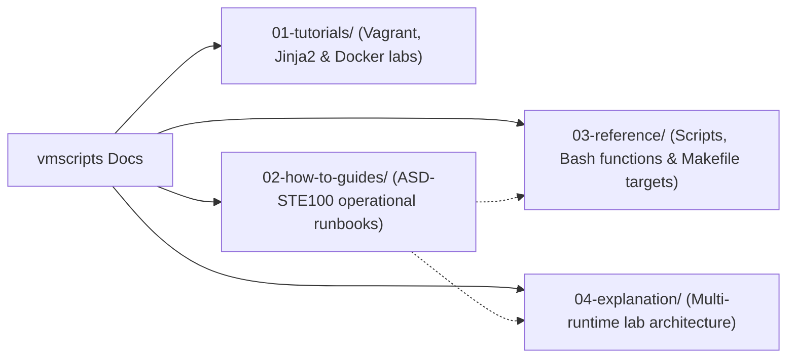

# vmscripts Documentation Portal

Diátaxis documentation for **vmscripts**, covering VirtualBox/Vagrant lab provisioning, Jinja2 config generation, Docker database sandboxes, Linode CLI wrappers, and LXD bridge forwarding.

## Quadrants

| Quadrant | Focus | Entry Point |
| :--- | :--- | :--- |
| **Tutorials** | Hands-on Vagrant config generation, Docker DB sandboxes, and Linode script generation | [01-tutorials/index.md](01-tutorials/index.md) |
| **How-To Guides** | Strict ASD-STE100 Issue 9 runbooks for VM provisioning, Docker, and cloud cleanup | [02-how-to-guides/index.md](02-how-to-guides/index.md) |
| **Reference** | Exhaustive inventory of Bash functions, Python generators, JSON keys, and Makefile targets | [03-reference/index.md](03-reference/index.md) |
| **Explanation** | Design comparison across `vms/`, `vm-vagrant/`, `docker/`, `linode/`, and `lxd/` | [04-explanation/index.md](04-explanation/index.md) |

## Companion Files

- [Repository README](../README.md) — Top-level overview and component map.
- [howto.md](../howto.md) — Quick Vagrant plugin and VirtualBox setup guide.
- [docker/README.md](../docker/README.md) — Docker Makefile, Compose, and Dockerfile reference.
- [notes.md](../notes.md) — External `dbscripts` multi-node execution notes.
