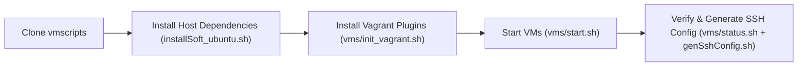

# Vagrant and VirtualBox VM Lab Walkthrough

This walkthrough prepares Vagrant plugins, launches multi-node VirtualBox labs under `vms/`, and verifies SSH connectivity. For task-focused runbooks, see [docs/02-how-to-guides/provision-vagrant-and-j2-labs.md](docs/02-how-to-guides/provision-vagrant-and-j2-labs.md).



## 1. Clone `vmscripts`

```bash
git clone https://github.com/jmrenouard/vmscripts.git
cd vmscripts
```

## 2. Inspect Workstation Installers

Check whether Vagrant, VirtualBox, or related workstation tools are installed:

```bash
sh ./installSoft.sh check
```

Note that `installSoft.sh` and `installSoft2.sh` target RPM-based distributions (`dnf`) and stop after disk expansion (`exit 0` before calling `vms/init_vagrant.sh`). On Ubuntu/Debian hosts, review `installSoft_ubuntu.sh`.

## 3. Install Vagrant Plugins (`vms/init_vagrant.sh`)

Install `vagrant-vbguest`, `vagrant-hostmanager`, and `vagrant-persistent-storage`:

```bash
cd vms
sh init_vagrant.sh
```

Verify installed plugins:

```bash
sh init_vagrant.sh check
```

Expected plugin output:

```text
vagrant-hostmanager (1.8.9, global)
vagrant-persistent-storage (0.0.49, global)
vagrant-vbguest (0.29.0, global)
```

## 4. Generate `Vagrantfile` / Ansible Inventory (Optional)

Customize `vms/config.py` defaults or override parameters via `vms/mygenconf.py` and `vms/mygenscript.py` (see [Tutorial 1](docs/01-tutorials/01-vagrant-and-vm-lab-setup.md)). For JSON + Jinja2 workflows, switch to `vm-vagrant/` and run `make generate`.

## 5. Start and Verify VirtualBox VMs

Start all defined VMs with VirtualBox provisioning:

```bash
sh start.sh
sh status.sh
```

> **Security Warning**: `vms/id_rsa` and `vms/provision_generic.sh` ship legacy training key material. Replace those keys with freshly generated SSH keys before booting shared or bridged network VMs.

## 6. Configure SSH Access and Load Shell Helpers

Generate `$HOME/.ssh/config` from `vms/Vagrantfile` private network entries:

```bash
sh genSshConfig.sh
```

Load `profile` and `vagrant.sh` from your interactive shell:

```bash
cd ..
source ./vagrant.sh
```

## 7. Clean Up or Destroy VMs

Halt or destroy the lab VMs when finished (`vms/destroy.sh` removes matching `*_data.vdi` disks as well):

```bash
cd vms
sh stop.sh
```
